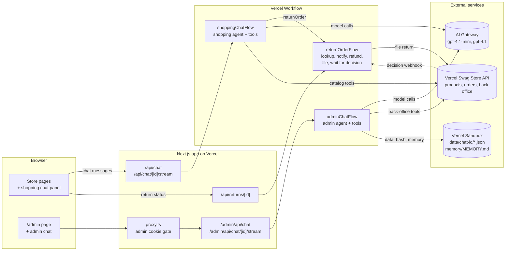
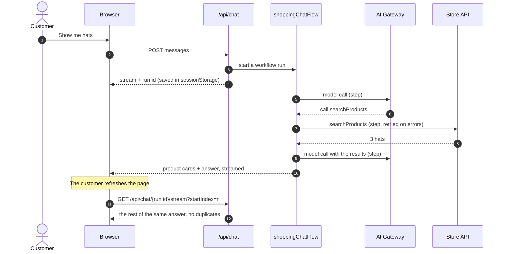
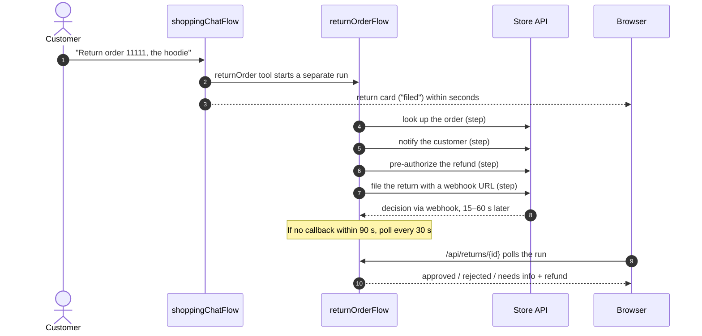
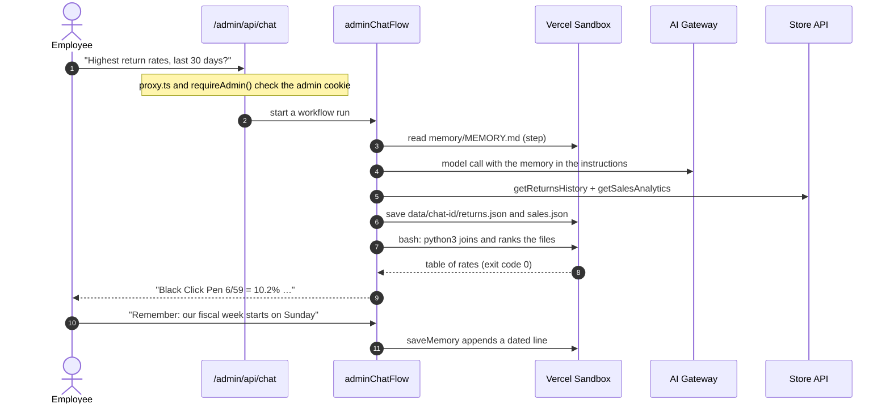
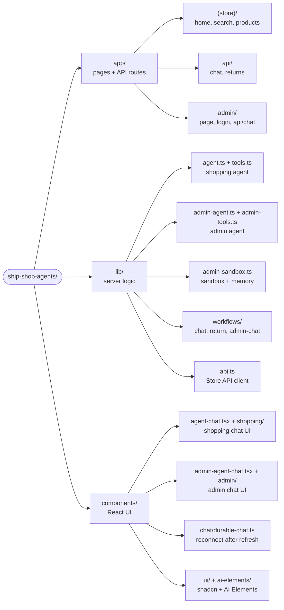

# Ship It Shop — Store Agents

An online store (the Vercel Swag Store) with two AI assistants built in:

- **Shopping agent** for customers. It sits in a side panel on every store page. Customers ask for products in plain language, get product cards they can add to the cart, and can return an order.
- **Store admin agent** for employees, at `/admin`. Employees ask about support tickets, returns, stock and sales. It runs its calculations as code in a **Vercel Sandbox** and remembers preferences in a **memory file** kept in that sandbox.

Built with Next.js 16, the AI SDK, Vercel Workflow, Vercel Sandbox and AI Gateway, for the Vercel Agent Foundations certification.

**Live:** https://vercel-agent-foundations-certificat-ruddy-rho.vercel.app · **Admin:** [`/admin`](https://vercel-agent-foundations-certificat-ruddy-rho.vercel.app/admin) (use the admin password from the assignment brief)

## Contents

- [How it works in one minute](#how-it-works-in-one-minute)
- [Architecture](#architecture)
- [How a request flows](#how-a-request-flows)
- [Repository map](#repository-map)
- [Try it](#try-it)
- [Requirements → implementation](#requirements--implementation)
- [Implementation decisions](#implementation-decisions)
- [Setup](#setup)
- [Environment variables](#environment-variables)
- [Scripts](#scripts)
- [Testing](#testing)
- [Known limitations](#known-limitations)

## How it works in one minute

1. **The browser** shows the store and a chat panel. When you send a message, it goes to a route in this Next.js app.
2. **The route starts a workflow run** (Vercel Workflow). A workflow is a function whose steps are saved as they finish. If something fails, a step is retried, and finished steps never run twice.
3. **Inside the run, an agent** (the AI SDK's `WorkflowAgent`) calls an AI model through **AI Gateway**. The model decides which **tools** to call: search products, read sales, run a command, and so on.
4. **Tools read live data** from the Store API. They never change store data, except for filing a return when a customer asks.
5. **The answer streams back** to the browser as it's written. The stream is stored with the run, so after a page refresh the browser reconnects and continues where it stopped.
6. **The admin agent also has a sandbox.** Data the admin agent fetches is saved into a private Vercel Sandbox, and the agent runs Python, `jq` or Node there to calculate. The same sandbox keeps `memory/MEMORY.md`, which is read at the start of every admin conversation.

## Architecture



| Part | What it does | Where |
| --- | --- | --- |
| Store pages | Products, search, product pages, cart (from the starter template) | `app/(store)/`, `components/` |
| Shopping chat | Chat panel, product cards, return card, refresh recovery | `components/agent-chat.tsx`, `components/shopping/`, `components/chat/` |
| Admin chat | Sign-in-protected chat with tool results and sandbox blocks | `app/admin/`, `components/admin-agent-chat.tsx`, `components/admin/` |
| API routes | Start a workflow run, replay its stream, report return status | `app/api/`, `app/admin/api/` |
| Workflows | Durable runs for the two chats and for returns | `lib/workflows/` |
| Agents and tools | Instructions, model choice, tool definitions | `lib/agent.ts`, `lib/tools.ts`, `lib/admin-agent.ts`, `lib/admin-tools.ts` |
| Sandbox | Persistent microVM for calculations and the memory file | `lib/admin-sandbox.ts` |
| Store API client | Typed `fetch` wrapper; adds the server-only bypass secret | `lib/api.ts` |

## How a request flows

Each item below opens a step-by-step diagram of one feature, from the browser to the services and back.

<details>
<summary><strong>1. A shopping question, with a page refresh in the middle</strong></summary>



</details>

<details>
<summary><strong>2. Returning an order</strong></summary>



</details>

<details>
<summary><strong>3. An admin question that needs a calculation</strong></summary>



</details>

## Repository map



```
ship-shop-agents/
├── app/
│   ├── (store)/                     Store pages (from the template)
│   │   ├── page.tsx                 Home
│   │   ├── search/                  Search page
│   │   └── products/[param]/        Product pages
│   ├── api/
│   │   ├── chat/route.ts            Shopping chat: starts shoppingChatFlow
│   │   ├── chat/[id]/stream/        Replays a shopping run after a refresh
│   │   └── returns/[id]/            Status of a return run
│   ├── admin/
│   │   ├── page.tsx                 Admin chat page (protected)
│   │   ├── login/                   Admin sign-in
│   │   └── api/chat/                Admin chat route + its replay endpoint
│   └── layout.tsx                   Root layout (header, cart, chat panel)
├── lib/
│   ├── agent.ts                     Shopping agent: model + instructions
│   ├── tools.ts                     Shopping tools (search, details, categories, returnOrder)
│   ├── admin-agent.ts               Admin agent: model + instructions (+ memory)
│   ├── admin-tools.ts               Back-office, bash and saveMemory tools
│   ├── admin-sandbox.ts             Vercel Sandbox: datasets, commands, memory file
│   ├── admin-guard.ts               Admin cookie check for API routes
│   ├── workflows/
│   │   ├── chat-flow.ts             shoppingChatFlow
│   │   ├── return-flow.ts           returnOrderFlow
│   │   └── admin-chat-flow.ts       adminChatFlow
│   ├── api.ts                       Typed Store API client (server-only)
│   └── cart-actions.ts, …           Cart server actions (from the template)
├── components/
│   ├── agent-chat.tsx               Shopping chat panel
│   ├── shopping/                    Product cards, return card, tool states
│   ├── admin-agent-chat.tsx         Admin chat
│   ├── admin/                       Tool results, sandbox command block
│   ├── chat/durable-chat.ts         useChat + reconnect after refresh
│   ├── ai-elements/                 AI Elements (conversation, message, input)
│   └── ui/                          shadcn/ui components
├── proxy.ts                         Redirects /admin/* to sign-in without the cookie
├── next.config.mjs                  Next.js + Workflow (withWorkflow)
└── .env.example                     Environment variable template (no values)
```

## Try it

**Shopping agent.** Open the site and click the agent button in the header.

| Ask | What you should see |
| --- | --- |
| "Show me hats" | Product cards with images, prices and links. |
| "Tell me about the Black Beanie" | A detail card with live stock and an **Add to cart** button that updates the header cart. |
| "Tell me about product unicorn_999" | "No product matches that request." The agent doesn't invent one. |
| "I want to return order 11111, the hoodie and desk mat, they don't fit" | A return card within a few seconds. The store's decision arrives about 15–60 s later and the card updates itself. Demo orders 11111, 22222 and 33333 can be returned; 44444 and 55555 can't, and the agent explains why. |
| Refresh the page while an answer is streaming | The answer continues from where it stopped, with no duplicate message and no second request to the model. |

**Admin agent.** Sign in at `/admin`; the suggestion buttons cover the main cases.

| Ask | What you should see |
| --- | --- |
| "Summarize this week's revenue" | Totals from `getSalesAnalytics` with the exact date range. |
| "Which products had the highest return rates in the last 30 days?" | A **Vercel Sandbox** block (Running… → Done in 0.1 s) with the Python command and its output, then a ranked answer (e.g. Black Click Pen 6/59 = 10.2%). |
| "Which low-stock products sold the most this month?" | Inventory and sales joined in the sandbox. |
| "Run cat data/nope.json in the sandbox." | The block shows **Failed (exit 1)** with stderr, and the agent explains the failure. |
| "Remember that our fiscal week runs Sunday to Saturday." then **New chat** and "When does our fiscal week start?" | A **Saved to memory** chip, and the new conversation knows the answer. |
| "Restock the Black Pullover Hoodie with 50 units." | A refusal: the store data is read-only. |

## Requirements → implementation

| Requirement | Where |
| --- | --- |
| Shopping tools `searchProducts`, `getAllCategories`, `getProductDetails`, `returnOrder` | `lib/tools.ts` |
| Generative UI (product cards, detail card, return card, tool states) | `components/shopping/*`, `components/agent-chat.tsx` |
| Durable chat + reconnect after refresh | `lib/workflows/chat-flow.ts`, `app/api/chat/route.ts`, `app/api/chat/[id]/stream/route.ts`, `components/chat/durable-chat.ts` |
| Durable return flow (lookup → notify → pre-authorize refund → file → wait for the store's decision) | `lib/workflows/return-flow.ts`, `app/api/returns/[id]/route.ts` |
| Admin tools `getSupportTickets`, `getReturnsHistory`, `getInventoryStock` (paginated), `getSalesAnalytics` + catalog tools, read-only | `lib/admin-tools.ts` |
| Admin agent only for signed-in admins | `proxy.ts` (redirect) + `lib/admin-guard.ts` (401 in the API route) |
| Durable admin chat + reconnect | `lib/workflows/admin-chat-flow.ts`, `app/admin/api/chat/**` |
| Vercel Sandbox bash tool (admin-only) with running / done / failed UI | `lib/admin-sandbox.ts`, `bash` in `lib/admin-tools.ts`, `components/admin/sandbox-command.tsx` |
| Persistent memory file in the same sandbox, read by app code at the start of each conversation, appended by the agent, empty memory handled | `readMemory` / `appendMemory` in `lib/admin-sandbox.ts`, `readAdminMemoryStep` in `lib/workflows/admin-chat-flow.ts`, `saveMemory` in `lib/admin-tools.ts` |
| AI Elements UI, responsive and accessible | `components/ai-elements/*`, both chat components (tested at 390 px and 1280 px) |
| AI Gateway | Model strings such as `openai/gpt-4.1-mini` in `lib/agent.ts` and `lib/admin-agent.ts` |
| Validated inputs | zod schemas on every tool and route body |
| Secrets never exposed | `BYPASS_SECRET` and the admin password are used only on the server; tool results never include them; memory rejects secret-like notes |

## Implementation decisions

- **Durability.** Both chats use `WorkflowAgent` from `@ai-sdk/workflow`: every model call and tool `execute` is a Workflow step. Transient Store API errors are thrown so the step retries; 400/404/422 responses come back to the model as a status it can explain. The client saves the run id and replays the stream from `startIndex` after a refresh, so work is never repeated.
- **Returns.** The return flow is its own workflow, so the chat answers right away and the decision arrives later. The flow waits up to 90 s for the store's callback on a Workflow webhook, then polls every 30 s (up to 8 times). Preview deployments sit behind deployment protection, which blocks the callback, so there the decision comes from polling.
- **Sandbox.** There is one named, persistent sandbox per environment (`ship-shop-admin-<VERCEL_ENV>`), created on first use with `Sandbox.getOrCreate`. Network access is denied: commands only work on files the app wrote. Each conversation gets its own folder (`data/chat-<id>/`), so simultaneous admins can't overwrite each other's data; folders older than a day are removed. Commands have a 60 s limit and output is capped at 12,000 characters.
- **No arithmetic in the model.** The admin instructions require all counting, joins and rankings to run in the sandbox. They define the return rate (units in all return requests ÷ units sold in the same range) and require a sanity check before answering.
- **Memory.** App code, not the agent, reads `memory/MEMORY.md` in a workflow step at the start of every admin conversation and puts it in the instructions ("nothing saved yet" when empty). The agent appends dated preference, correction or business-context lines; duplicates and secret-like notes are rejected on the server.
- **Admin isolation.** The admin API lives under `/admin/api/*` because the admin cookie is scoped to `/admin` and `proxy.ts` guards that path; the route checks the cookie again. Admin tools are never given to the shopping agent, and each replay endpoint only replays runs of its own workflow.
- **Models.** Shopping uses `openai/gpt-4.1-mini`: in a comparison of four models it was fast and didn't invent prices. Admin uses `openai/gpt-4.1` for multi-step reasoning. Both can be changed with env vars.

## Setup

Prerequisites: Node.js 22+, pnpm, the Vercel CLI and a Vercel project created from the assignment's template (so `BYPASS_SECRET` and `API_BASE_URL` are set).

```bash
pnpm install
vercel link                  # pick your team and the project
vercel env pull .env.local   # BYPASS_SECRET, API_BASE_URL, VERCEL_OIDC_TOKEN
pnpm dev                     # http://localhost:3000
```

Without the Vercel CLI, copy `.env.example` to `.env.local` and fill it in. Locally, the OIDC token authenticates both AI Gateway and Vercel Sandbox. It expires after 12 hours, so run `vercel env pull` again when calls start failing. On Vercel, OIDC is automatic. Deploy by pushing to the connected Git repository (or `vercel --prod`); no extra configuration is needed.

## Environment variables

| Variable | Required | Description |
| --- | --- | --- |
| `BYPASS_SECRET` | Yes | Deployment-protection bypass secret for the Store API, sent from the server as `x-vercel-protection-bypass`. Server-only; never prefix with `NEXT_PUBLIC_`. |
| `API_BASE_URL` | Yes | Store API base URL, ending in `/api`. Set by the template. |
| `VERCEL_OIDC_TOKEN` | Locally | Written by `vercel env pull`. Authenticates AI Gateway and Vercel Sandbox locally (expires after 12 h). Automatic on Vercel. |
| `AI_GATEWAY_API_KEY` | No | AI Gateway API key, used instead of OIDC for model calls when set. |
| `SHOPPING_AGENT_MODEL` | No | AI Gateway model for the shopping agent (must support tools). Default `openai/gpt-4.1-mini`. |
| `ADMIN_AGENT_MODEL` | No | AI Gateway model for the admin agent (must support tools). Default `openai/gpt-4.1`. |
| `NEXT_PUBLIC_SITE_URL` | No | Public site URL for metadata. Default `http://localhost:3000`. |

The app also reads Vercel's system variables `VERCEL_ENV` (which sandbox to use) and `VERCEL_URL` / `VERCEL_PROJECT_PRODUCTION_URL` (the return webhook URL). Vercel sets these automatically.

## Scripts

| Command | Description |
| --- | --- |
| `pnpm dev` | Dev server on http://localhost:3000 |
| `pnpm build` / `pnpm start` | Production build / serve it |
| `pnpm lint` | ESLint |
| `pnpm type-check` | `tsc --noEmit` |

## Testing

There is no unit-test framework. Each change was verified with `pnpm type-check`, `pnpm lint` and `pnpm build`, plus end-to-end checks against a local server, the Vercel preview and production:

- Playwright runs in Chromium (1280 px) and WebKit (390 px): product cards, add to cart, not-found, return card, refresh mid-answer (1 POST, 1 resume, no duplicates), admin sign-in, sandbox Running / Done / Failed states, memory chip, no horizontal overflow, no console errors.
- Admin answers compared with numbers computed directly from the Store API: return rates, low-stock top sellers, returns by decision, revenue by category, ticket categories, open urgent tickets, out-of-stock products.
- Concurrent admin conversations each used their own sandbox folder and got correct results.
- Durability: a simulated Store API outage was retried, and a failure injected mid-return didn't repeat completed steps.
- No secrets in streamed answers (including a prompt-injection attempt) or in the client JavaScript.

## Known limitations

- The admin login is the template's demo gate: a fixed password, with the cookie value equal to the password. Production would need real authentication.
- Sandbox datasets are a snapshot from the agent's last fetch in that conversation; the agent fetches again for new questions or ranges.
- On preview deployments, return decisions arrive by polling, because deployment protection blocks the store's webhook.
